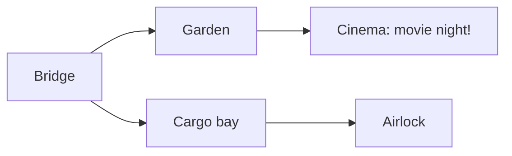

# Operation: Snack Rescue
# Score 100

:::case rescue | Mission control
:::panel The mission
Movie night is about to start aboard the **Starship Munch**. The snack robots have wandered off with the supplies!

Your crew must unlock the console, find the cinema, and bring the snacks home.

:::panel Ship map
Follow the arrows to reach movie night. The airlock is definitely the wrong venue.

:::panel Robot tracker
| Robot | Snack cargo | Access badge |
| --- | --- | --- |
| Pip | Popcorn | Blue |
| Beep | Pretzels | Green |
| Nova | Lemonade | Gold |

**Snack rule:** Popcorn and pretzels are crunchy. Lemonade is a drink.

**Door rule:** Only a gold badge opens the cinema.
:::endcase

## Q1: The console asks: "I have keys but no locks, and a space bar but no drinks." What am I?
::case=rescue
- [ ] A toaster
- [ ] A treasure chest
- [x] A keyboard
::time=20

## Q2: Check the ship map. Which room should you enter from the Bridge to reach the Cinema?
::case=rescue
- [x] Garden
- [ ] Cargo bay
- [ ] Airlock
::time=35

## Q3: The crew wants a crunchy snack. Check the robot tracker and pick one robot with suitable cargo.
::case=rescue
- [x] Pip with popcorn
- [x] Beep with pretzels
- [ ] Nova with lemonade
::time=30

# Section: The final rescue
> The snacks are safe. One locked door stands between your crew and movie night.

## Q4: Check the door rule and robot tracker. Which robot can open the Cinema?
::case=rescue
- [ ] Pip, with the blue badge
- [ ] Beep, with the green badge
- [x] Nova, with the gold badge
::time=25

## Q5: Mission complete! Which movie-night job would you choose? Every choice is welcome — this one is just for fun.
::type=ungraded
- [x] Snack captain: guard the popcorn
- [x] Robot DJ: set the mood
- [x] Sofa commander: claim the best seat
::time=15
